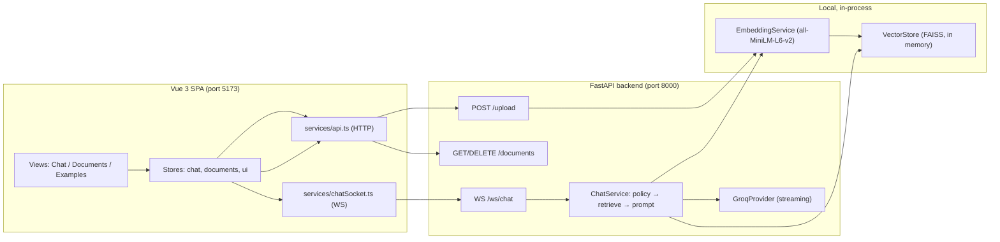

# 00 — Project Architecture

**Overview:** DevAssist is a local, single-user, programming-only chat assistant with retrieval-augmented generation (RAG). You upload your own documents (PDF/TXT/Markdown), the backend chunks and embeds them on your machine, and a Groq-hosted LLM answers questions using the most relevant excerpts, streamed back over a WebSocket. This document explains the big picture: what the application is, how its parts fit together, and how data flows through a full request.

**Scope:** The problem the app solves, its two-process architecture, the responsibilities of every major component, key dependencies, and an end-to-end data-flow trace.

**Prerequisites:** Basic programming knowledge is enough. Read this first — every other Knowledge Byte builds on the architecture described here.

**Important source files:**
- `backend/app/main.py`
- `backend/app/api/chat_ws.py`
- `backend/app/api/upload.py`
- `backend/app/services/chat_service.py`
- `frontend/src/App.vue`
- `frontend/src/stores/chat.ts`
- `README.md`

---

### Byte 1: The problem DevAssist solves

**Builds on:** None — starting point

**Source files:** `README.md`, `PROJECT_STATUS.md`

**In plain terms:**

DevAssist answers programming questions *using your own documents as evidence*. Instead of a general chatbot, it is a narrow assistant: it refuses non-programming topics, cites the uploaded file and chunk number when it uses one, and never sends your API key to the browser.

**The code:**

```markdown
DevAssist is a local, single-user programming assistant. You upload your own
documentation (PDF, TXT or Markdown), it is chunked and embedded on your machine,
and a Groq-hosted LLM answers your programming questions using the retrieved
excerpts, streaming the answer back over a WebSocket.
```

**What's happening:**

This is the root `README.md` describing the product in one sentence. Three words carry the architecture: *local* (embedding and indexing run on your machine), *chunked and embedded* (the RAG pipeline), and *streaming over a WebSocket* (the transport for answers).

**Why it matters:**

Every design choice in the repository follows from these three properties: there is no database because storage is transient and local; there is no authentication because the app is single-user; and the LLM call is the *only* thing that leaves the machine.

**Trace it further:** Continue with Byte 2 to see the two processes that implement this.

---

### Byte 2: The two-process architecture

**Builds on:** Byte 1

**Source files:** `backend/app/main.py`, `frontend/src/main.ts`, `frontend/vite.config.ts`

**In plain terms:**

The application is two separate programs: a FastAPI backend (Python) serving an HTTP + WebSocket API on port 8000, and a Vue 3 single-page app (TypeScript) served by Vite on port 5173. The browser talks only to the frontend's dev server, which proxies API traffic to the backend.

**The code:**

```python
# backend/app/main.py — the FastAPI application is built once at import time
app = create_app()
```

```typescript
// frontend/src/main.ts — the SPA mounts a single root component
createApp(App).mount('#app')
```

**What's happening:**

`create_app()` wires routers, CORS, error handlers and the `lifespan` startup hook (see [02 — Application startup and request flow](02-application-startup-and-request-flow.md)). The Vue app has no router library — `App.vue` swaps between three views (`chat`, `documents`, `examples`) based on UI-store state. In development, `vite.config.ts` proxies `/health`, `/upload`, `/documents` and `/ws` to `http://127.0.0.1:8000`, so the browser never needs to know the backend's address.

**Why it matters:**

The split is what keeps the Groq API key server-side: the browser issues only document and chat requests through the proxy; the LLM call happens inside the backend process. If the processes are not both running, the frontend shows a `NETWORK_ERROR` rather than crashing.

**Trace it further:** The Mermaid diagram in Byte 3 shows how a request crosses this boundary.

---

### Byte 3: Component map and data flow

**Builds on:** Byte 2

**Source files:** `backend/app/main.py`, `backend/app/api/upload.py`, `backend/app/api/chat_ws.py`, `backend/app/services/chat_service.py`

**In plain terms:**

The frontend has two pipelines: a document pipeline (upload → index) and a chat pipeline (question → retrieve → stream answer). Both terminate in the backend, but they use different transports — HTTP for documents, WebSocket for chat.

**The code:**



**What's happening:**

Uploads flow left-to-right into the local index: `POST /upload` extracts text, chunks it, embeds it, and stores vectors in the in-memory FAISS index. Chat questions flow through `ChatService.prepare()` (policy check → retrieval from the same index → prompt assembly) and then `ChatService.stream()` yields text deltas from Groq, which the WebSocket handler forwards as `token` events.

**Why it matters:**

Both pipelines converge on the same two singletons — `EmbeddingService` and `VectorStore` — which is why the backend must run with a single worker (see [03 — Data layer and database](03-data-layer-and-database.md)). Understanding this diagram is the map for every other document in this guide.

**Trace it further:** [01 — Project structure](01-project-structure.md) locates each box in the repository.

---

### Byte 4: Backend layering

**Builds on:** Byte 3

**Source files:** `backend/app/api/`, `backend/app/services/`, `backend/app/core/`, `backend/app/schemas/`, `backend/app/prompts/`

**In plain terms:**

The backend is split into five layers, each with one job: *API* (HTTP/WebSocket endpoints), *services* (business logic), *schemas* (typed request/response models), *core* (settings, errors, logging), and *prompts* (the guardrail text).

**The code:**

```python
# backend/app/api/__init__.py — routers are re-exported for main.py
from app.api.chat_ws import router as chat_router
from app.api.upload import router as upload_router
```

**What's happening:**

Routers parse and validate input, then delegate to services. Services never import routers. `app/core/errors.py` defines the shared `AppError` hierarchy that any layer can raise and `main.py` converts into a safe JSON error response. Pydantic schemas (`app/schemas/`) are the contract between layers and over the wire.

**Why it matters:**

This layering is what makes the code testable: tests inject fake embeddings, fake stores, and fake providers through constructor seams (`ChatService.__init__`) and singleton setters (`set_provider`), without touching endpoint code.

**Trace it further:** [01 — Project structure](01-project-structure.md) gives the full folder tour.

---

### Byte 5: Frontend layering

**Builds on:** Byte 3

**Source files:** `frontend/src/App.vue`, `frontend/src/stores/`, `frontend/src/services/`, `frontend/src/components/`

**In plain terms:**

The frontend follows a "store + service + component" pattern with no router and no state-library dependency: three plain-Vue-reactivity stores hold all state, two service modules own all network communication, and components render state and emit user intent.

**The code:**

```typescript
// frontend/src/stores/documents.ts — plain reactivity, no Pinia
import { reactive, readonly } from 'vue'

const state = reactive<DocumentsState>({ /* … */ })

export function useDocumentsStore() {
  return { state: readonly(state), refresh, uploadFiles, /* … */ }
}
```

**What's happening:**

Each store exports a `readonly` view of its reactive state plus action functions, so components can read state but only store actions mutate it (the `mutableState` getter is an explicit escape hatch used by dialogs and tests). Components never call `fetch` directly — all HTTP goes through `services/api.ts` and all WebSocket traffic through `services/chatSocket.ts`.

**Why it matters:**

Because state is module-scoped and reactive, switching views in `App.vue` preserves the conversation and document list with no router or persistence layer. The trade-off is that everything is lost on page reload — a deliberate, documented limitation (see [08 — Cart and session management](08-cart-and-session-management.md)).

**Trace it further:** [15 — Frontend views, JavaScript, and CSS](15-frontend-views-javascript-css.md) covers the component tree in detail.

---

### Byte 6: Key dependencies

**Builds on:** Byte 4, Byte 5

**Source files:** `backend/requirements.txt`, `frontend/package.json`

**In plain terms:**

The backend's load-bearing dependencies are FastAPI (web framework), FAISS (vector similarity search), sentence-transformers (embeddings), pypdf (PDF parsing) and the Groq SDK (LLM streaming). The frontend uses Vue 3, Vite, Tailwind CSS v4, markdown-it and highlight.js.

**The code:**

```text
# backend/requirements.txt (excerpt)
fastapi>=0.115,<1.0
faiss-cpu>=1.8.0
sentence-transformers>=3.0,<6.0
groq>=0.13,<1.0
```

```json
// frontend/package.json (excerpt)
"dependencies": {
  "highlight.js": "^11.12.0",
  "markdown-it": "^15.0.3",
  "vue": "^3.5.42"
}
```

**What's happening:**

Every dependency maps to a specific responsibility: `faiss-cpu` provides the `IndexFlatIP` inner-product index (cosine similarity over normalized vectors), `sentence-transformers` provides `all-MiniLM-L6-v2` (384-dimensional embeddings, downloaded once and cached), `pypdf` extracts text from PDFs, and `groq` streams completions. On the frontend, `markdown-it` renders assistant answers safely and `highlight.js` colors code blocks.

**Why it matters:**

The choice of *local* embeddings (sentence-transformers) rather than an embedding API is why retrieval works with no network access after the first model download, and why the app needs exactly one secret: `GROQ_API_KEY`.

**Trace it further:** [03 — Data layer and database](03-data-layer-and-database.md) explains FAISS and embeddings in depth.

---

### Byte 7: What is deliberately absent

**Builds on:** All previous bytes

**Source files:** `README.md`, `PROJECT_STATUS.md`

**In plain terms:**

Several features you might expect are *intentionally not part of this project*: there is no database, no user accounts or authentication, no Docker, no admin panel, and no persistence. Knowing this up front prevents misreading missing features as bugs.

**The code:**

```markdown
- **No database, no auth, no Docker.** The document index and the chat history
  live in memory only.
- **No API key ever reaches the browser.** `GROQ_API_KEY` is read by the backend
  from `backend/.env` and used only server-side.
```

**What's happening:**

This is the root README's feature-boundary statement, confirmed by the code: no ORM or migration files exist anywhere in `backend/`, no session or token logic exists, and the only browser storage used is a theme preference (`localStorage` key `devassist-theme` in `frontend/src/stores/ui.ts`).

**Why it matters:**

Several documents in this Knowledge Bytes set (checkout, orders, wishlist, IIS) describe features that do not exist here. Those documents explicitly document the closest implemented equivalent instead of inventing functionality. See [05 — Product catalog](05-product-catalog.md) for the first example of this pattern.

**Trace it further:** [16 — Validation, security, and error handling](16-validation-security-and-error-handling.md) explains what protects an app that has no login.

---

## Continue learning

- [01 — Project structure](01-project-structure.md) — where every feature lives on disk.
- [02 — Application startup and request flow](02-application-startup-and-request-flow.md) — what happens when the server boots and a user acts.
- [18 — Testing and verification](18-testing-and-verification.md) — how the architecture is kept honest by tests.
